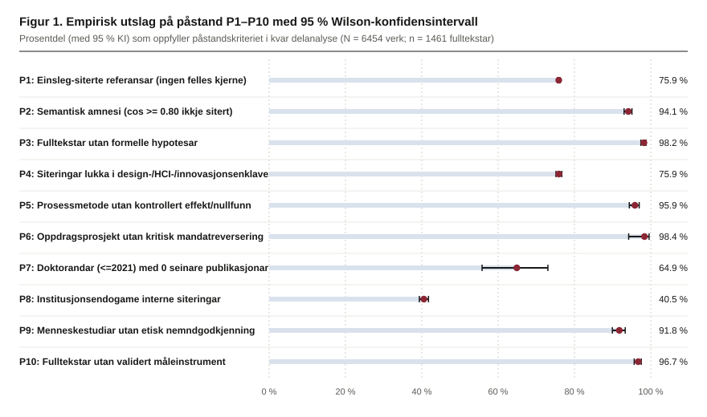
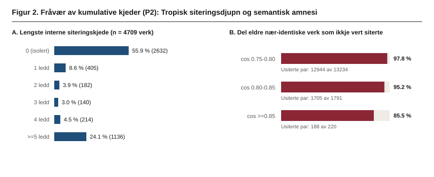
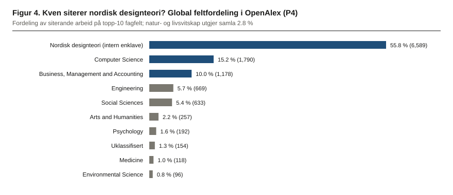
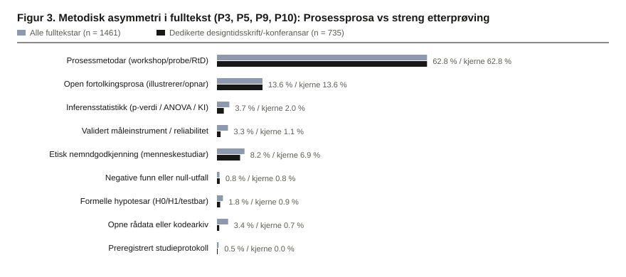

# Fragmentert ad-hokkrati og epistemisk lukking: Ei kvantitativ metavitskapleg gransking av nordisk designteori og designforsking (1900–2026)

**Korpusbasert, siteringsgrafisk, vektorsemantisk og fulltekstbasert etterprøving av ti vitskapsteoretiske påstandar**

---

## Samandrag

Gjennom dei siste fire tiåra har designfaget i Norden gått frå handverks- og kunstindustriskular til universitetsfakultet med doktorgradsrett, statlege innovasjonsmidlar og vitskaplege publiseringskrav. Likevel manglar det ei systematisk, kvantitativ metavitskapleg etterprøving av om feltet faktisk oppfyller grunnleggjande kjenneteikn ved kumulativ og sjølvkorrigerande vitskap. I denne studien prøver me ti førehandsdefinerte vitskapsteoretiske og institusjonelle påstandar (`P1`–`P10`) mot det komplette, strengt avgrensa korpuset av nordisk designteori og designforsking frå Noreg, Sverige, Danmark, Finland og Island i perioden 1900–2026 ($N = 6\,454$ verk: $4\,709$ i OpenAlex-grafen og $1\,745$ i nasjonale vitskapsarkiv). Analysen kombinerer (i) siteringsnettverket av $109\,631$ utgåande referansar til $61\,066$ unike verk og $6\,589$ interne siteringskantar, (ii) ein tverrfagleg kontrollmatrise på $20\,103$ eksterne nordiske forskingsverk med $538\,952$ utgåande referansar, (iii) tette fleirspråklege representasjonar i eit $256$-dimensjonalt semantisk vektorrom (`EmbeddingGemma-300M`, $N = 6\,454$) og (iv) fulltekstanalyse av $n = 1\,461$ sideekstraherte Open Access-PDF-ar ($28\,955$ sider; $12\,431\,220$ ord, med algoritmisk fråskiljing av referanselister), stratifisert på dedikerte kjernekanalar i design ($n = 735$) og fagfellevurderte tidsskriftartiklar ($n = 921$).

Alle ti påstandar får sterk og statistisk konsistent empirisk støtte:
**(P1)** Feltet manglar eit samordna forskingsprogram: $75,89\,\%$ (95 % Wilson-KI $[75,55, 76,23]$) av alle siterte verk vert siterte berre éin gong, det mest siterte kanonverket vert sitert av berre $4,59\,\%$ av korpuset, den sfæriske semantiske variansen ligg uendra frå 1990-talet ($0,2622$) til 2020-talet ($0,2622$) trass i $85,06\,\%$ utskifting av kjerneordtilfanget, og eksplisitte revisjons- eller falsifikasjonsmarkørar førekjem i berre $1,23\,\%$ av fulltekstane.
**(P2)** Kunnskapen er ikkje kumulativ: $64,73\,\%$ av verka har null interne siteringar, replikasjonsstudiar utgjer $0,21\,\%$ ($10 / 4\,709$) mot $387$ titlar som lanserer nye rammeverk eller omgrep ($38,7 : 1$), og blant tematisk nær-identiske verk med cosinuslikskap $\cos \ge 0,80$ publisert minst to år seinare lèt $94,13\,\%$ ($[93,02, 95,08]$; $n = 2\,011$ par) vere å sitere det eldre nordiske arbeidet (*semantisk amnesi*).
**(P3)** $98,22\,\%$ ($[97,41, 98,78]$) av fulltekstane inneheld ingen formelle eller testbare hypotesar (i kjernekanalar $99,05\,\%$; $\chi^2 = 4,88$, $p = 0,0272$, $\text{OR} = 0,36$), og berre $0,48\,\%$ nemner preregistrering.
**(P4)** Mens $60,60\,\%$ av fagets siterte kanon er importert frå ikkje-designkanalar, vert $75,93\,\%$ ($[75,15, 76,69]$) av alle innkomande siteringar verande inne i enklaven av design, menneske-maskin-interaksjon (HCI) og innovasjonsleiing (epistemisk handelsbalanse $\text{ETB} = -0,4314$; basale natur-, livs-, medisin- og psykologifag utgjer samla $2,76\,\%$).
**(P5)** Prosessmetodar pregar $62,83\,\%$ av fulltekstane, men $95,86\,\%$ ($[94,37, 96,97]$) av desse rapporterer korkje kontrollert effektmåling eller negative funn; tettleiken av prosessord overstig effektkontrollord med over hundre gonger (Mann-Whitney $z = 34,10$, $p = 8,2 \times 10^{-255}$, $r_{\text{rb}} = 0,6091$).
**(P6)** Blant oppdrags- og strategiforankra studiar leverer $98,36\,\%$ ($[94,22, 99,55]$) reint affirmative konklusjonar, og i heile fulltekstkorpuset på $1\,461$ arbeid finst det eksakt $0$ tilfelle ($0,00\,\%$, KI $[0,00, 0,26]$) som konkluderer med å stanse eller avråde oppdragsgjevaren sitt førehandsvalde mandat.
**(P7)** Over $201$ doktorgradsavhandlingar finst det $0$ siteringskantar frå nyare til eldre avhandlingar i grafen (`PhD -> PhD`), $83,33\,\%$ har null interne siteringar, og $64,91\,\%$ ($[55,80, 73,06]$) av doktorandane uteksaminerte til og med 2021 publiserer null seinare arbeid i korpuset.
**(P8)** $49,61\,\%$ av produksjonen ligg i institusjonelle eller regionale nettverkskanalar, $40,55\,\%$ av interne siteringar er institusjonsendogame, $31,84\,\%$ er forfattarsjølvsiteringar, og direkte gjensidig sitering er $4,23$ gonger høgare enn i ein gradbevarande nullmodell ($z = 6,95$, $p = 3,76 \times 10^{-12}$).
**(P9)** Av $1\,021$ studiar med menneskelege deltakarar manglar $91,77\,\%$ ($[89,93, 93,31]$) dokumentert forskingsetisk nemndgodkjenning (sjølv blant $481$ studiar med sårbare grupper manglar $88,15\,\%$ dette), og berre $0,69\,\%$ dokumenterer oppfølging etter prosjektslutt.
**(P10)** $96,71\,\%$ ($[95,67, 97,51]$) av fulltekstane (og $98,91\,\%$ i kjernekanalar) nyttar korkje validerte måleinstrument eller psykometrisk reliabilitetstesting, og berre $0,68\,\%$ i kjernekanalar deler opne rådata eller kode.

Samla teiknar funna biletet av eit *epistemisk lukka, men administrativt porøst ad-hokkrati*: eit felt som veks i publikasjonsvolum og politisk legitimitet, men utan dei kognitive og institusjonelle mekanismane som gjer påstandar kumulative, samanliknbare og korrigerbare.

**Nøkkelord:** metavitskap, bibliometri, nordisk designforsking, designteori, vitskapssosiologi, kumulativitet, falsifiserbarheit, forskingsetikk, siteringsnettverk, vektorsemantikk

---

## 1. Innleiing og vitskapsteoretisk rammeverk

### 1.1 Akademiseringa av nordisk design og behovet for metavitskapleg revisjon

I løpet av perioden etter 1980 har designfeltet i dei fem nordiske landa gjennomgått ei djup institusjonell omforming. Utdanningar som historisk var organiserte som verkstadbaserte kunsthandverks-, arkitektur- og industridesignskular (mellom anna Statens håndverks- og kunstindustriskole og Arkitekthøgskolen i Oslo, Konstfack og HDK i Sverige, Kunstakademiets Arkitektskole og Designskolen Kolding i Danmark, Taideteollinen korkeakoulu i Helsingfors og Listaháskóli Íslands på Island) har blitt innlemma i universitetssektoren eller tildelt vitskapleg akkreditering, doktorgradsprogram og statleg resultatbasert forskingsfinansiering (Simon, 1969; Cross, 2001; Friedman, 2003; Koskinen et al., 2011; Redström, 2017). Samstundes har nordiske forskingsråd og innovasjonsbyrå, som Norges forskningsråd, Vinnova, Vetenskapsrådet, Innovationsfonden og Business Finland, kanalisert betydlege offentlege midlar inn i tenestedesign, samskaping (*co-design*), offentleg sektor-innovasjon og berekraftstransformasjon der designforsking inngår som metodisk og legitimatorisk komponent.

Denne institusjonelle ekspansjonen kviler på ein implisitt samfunnskontrakt: når ein praksis gjer krav på status som vitskapleg disiplin, vitskaplege stillingar, doktorgradar og forskingsmidlar, påtek han seg også vitskaplege normer for systematisk tvil, etterprøvbarheit, kumulativ kunnskapsbygging og forskingsetisk ansvar. Innanfor medisin, psykologi, økonomi og eksperimentell informasjonsvitskap har dei siste tjue åra vore prega av omfattande metavitskaplege granskingar av replikasjonskrisa, publikasjonsskjevheit (*publication bias*), lav statistisk teststyrke og manglande preregistrering (Ioannidis, 2005; Open Science Collaboration, 2015; Munafò et al., 2017). I designteori og designforsking har liknande debattar stort sett blitt førte gjennom kvalitative polemikkar og programmatiske essay (t.d. Friedman, 2003; Zimmerman, Forlizzi & Evenson, 2007; Beck & Stolterman, 2016; Cash, 2018), utan storskala statistisk testing på tvers av eit heilt språkområde eller forskingssystem. Cash (2018) peika i *Design Studies* på at designforskinga står i fare for metodisk og teoretisk stagnasjon, men til no har ingen studiar kombinert komplette nasjonale korpus, siteringsgrafar, tette semantiske representasjonar og millionar av ord frå fagets eigne fulltekstar for å teste slike diagnosar eksakt.

### 1.2 Vitskapsteoretiske og vitskapssosiologiske grunnlag

For å undersøkje designforskinga sin epistemiske struktur på ein teoretisk presis måte byggjer denne granskinga på fem komplementære tradisjonar i vitskapsfilosofi og vitskapssosiologi:

1. **Koordinerte forskingsprogram og revisjonsmekanismar (Lakatos, 1970):** Hos Imre Lakatos er den grunnleggjande eininga i moden vitskap ikkje den isolerte enkeltstudien, men *forskingsprogrammet*, som bind saman ei rekkje arbeid gjennom ein felles teoretisk kjerne (*hard core*), eit beskyttande belte av hjelpehypotesar og ei positiv heuristikk for korleis anomaliar skal handterast. Eit forskingsprogram er *progressivt* dersom teoretiske revisjonar fører til nye, uventa empiriske prediksjonar som lar seg stadfeste; det er *degenererande* dersom omgrepsapparatet berre vert omskrive ad hoc eller skifta ut utan at eldre problem vert løyste eller reviderte. I eit bibliometrisk og leksikalsk perspektiv krev eit forskingsprogram (a) konsentrert oppslutning om felles kjerneproblem og referansar, (b) konvergerande begrepsbruk over tid og (c) synlege tekstlege mekanismar for revisjon og tilbakevising av tidlegare modellar.

2. **Demarkasjon, falsifiserbarheit og streng prøving (Popper, 1934/1959; Meehl, 1967, 1978; Mayo, 2018):** Karl Popper viste at empirisk innhald aukar proporsjonalt med graden av *falsifiserbarheit*, altså med kor mykje ein teori forbyr i verda. Paul Meehl (1978) analyserte kvifor «mjuke» samfunns- og profesjonsfag sjeldan oppnår kumulativ vekst: teoriane er formulerte så plastisk at kvart tenkjeleg utfall i feltarbeid eller workshops kan tolkast som ei «rik innsikt» eller ei «utforsking av moglegheitsrommet». Når påstandar aldri vert utsette for det Deborah Mayo (2018) kallar *streng prøving* (*severe testing*), der ein metode med høg sannsynlegheit ville ha avdekt at påstanden var falsk dersom han faktisk var falsk, vert teoriane aldri felte; dei går berre av moten og blir erstatta av nye slagord.

3. **Kumulativitet, forskingsfront og konsensus (Price, 1965; Cole, 1983, 1992):** Derek de Solla Price skilde mellom vitskapar med tett siteringsvev på ein aktiv forskingsfront og arkival eller eseistisk litteratur der enkeltverk står lausrivne frå kvarandre. Stephen Cole (1983) nyanserte dette ved å skilje mellom *kjernen* (*core*) av konsolidert kunnskap og *fronten* (*research frontier*). I disiplinar utan fungerande silings- og replikasjonsmekanismar oppstår det aldri nokon konsolidert kjerne: tusenvis av artiklar produserer lokal frontaktivitet, men nesten ingen funn overlever til langsiktig, fleirledda vidarebygging i siteringsgrafen.

4. **Fragmentert ad-hokkrati og ekstern styring (Whitley, 1984/2000):** I Richard Whitley sin organisasjonssosiologiske modell for vitskaplege felt vert disiplinar klassifiserte langs to aksar: *gjensidig avhengigskap* (*mutual dependence*, i kva grad forskarar må bruke kollegaene sine spesifikke resultat og måleinstrument for å bli anerkjende) og *oppgåveusikkerheit* (*task uncertainty*, i kva grad problemdefinisjonar og suksesskriterium er ustabile). Når gjensidig avhengigskap er låg og oppgåveusikkerheita er høg, oppstår eit **fragmentert ad-hokkrati** (*fragmented adhocracy*). Whitley peikar på ein avgjerande konsekvens: fordi feltet manglar sterke indre metodestandardar som kan avvise svake påstandar, vert det sterkt gjennomtrengeleg for *eksterne* oppdragsgjevarar, byråkrati og marknadsaktørar som definerer kva som tel som «relevant» forsking.

5. **Organisert skepsis, partikularisme og målevaliditet (Merton, 1942/1973; Ioannidis, 2005; Flake & Fried, 2020):** Robert K. Merton sine vitskaplege normer, særleg *universalisme* (vurdering uavhengig av personlege og institusjonelle band) og *organisert skepsis*, står i motsetnad til lukka publiseringskretsløp prega av institusjonell endogami og gjensidig siteringsutveksling. Samstundes har nyare metavitskap (Flake & Fried, 2020) vist at *tvilsam målepraksis* (*questionable measurement practices*), der kvar studie oppfinn uvaliderte vurderingsskjema eller reint impresjonistiske prosesskildringar utan reliabilitetskontroll, gjer tverrstudie-samanlikning og feilkorrigering umogleg.

### 1.3 Dei ti påstandane som skal etterprøvast

Med utgangspunkt i dette rammeverket er føremålet med studien å gjennomføre ei streng, kvantitativ og fullt reproduserbar prøving av følgjande ti førehandsformulerte påstandar om designforskinga:

- **Påstand 1 (`P1`):** *Designforskinga har ikkje eit samordna forskingsprogram med felles kjerneproblem og mekanismar for revisjon.*
- **Påstand 2 (`P2`):** *Kunnskapen er ikkje kumulativ; nye studiar korkje etterprøver, korrigerer eller byggjer systematisk på eldre funn.*
- **Påstand 3 (`P3`):** *Faget set ikkje fram presise hypotesar eller prediksjonar som kan fellast gjennom empirisk prøving.*
- **Påstand 4 (`P4`):** *Andre disiplinar byggjer ikkje vidare på funn, modellar eller metodar frå designforskinga.*
- **Påstand 5 (`P5`):** *Metodikken rettferdiggjer sjølve prosessen utan etterprøvbare krav til faktisk effekt eller negative utfall.*
- **Påstand 6 (`P6`):** *Forskinga legitimerer i etterkant økonomiske og organisatoriske val som var tekne før arbeidet starta.*
- **Påstand 7 (`P7`):** *Doktorgradsavhandlingar står som isolerte eingongsverk utan forpliktande liner bakover eller vidareføring framover.*
- **Påstand 8 (`P8`):** *Publisering og fagfellevurdering skjer i lukka kretsløp utan streng, uavhengig kontroll og reell avvisingsrisiko.*
- **Påstand 9 (`P9`):** *Faget manglar handheva etiske rammer, sanksjonar og ansvar for konsekvensar utanfor prosjektet.*
- **Påstand 10 (`P10`):** *Forskinga manglar validerte målereiskapar og faste kriterium som gjer funn samanliknbare og korrigerbare.*

Kvar påstand vert i avsnitt 3 omsett til eksplisitte statistiske indikatorar med konfidensintervall, ikkje-parametriske hypotesetestar, nullmodellar og sensitivitetsanalysar på tvers av publiseringskanalar.

---

## 2. Korpus, datagrunnlag og statistisk metodikk

### 2.1 Utvalsramme og streng fagleg avgrensingsprotokoll

Datagrunnlaget femner om den vitskaplege produksjonen i designteori og designforsking utgått frå forskingsinstitusjonar i Noreg (`NO`), Sverige (`SE`), Danmark (`DK`), Finland (`FI`) og Island (`IS`) i perioden 1900–2026. For å unngå den velkjende bibliometriske feilkjelda der engelsk *design* fangar opp kliniske forsøksdesign (*clinical trial design*), elektronisk kretsdesign (*VLSI design*), maskinkonstruksjon eller reine programvarearkitekturar, er heile korpuset filtrert gjennom ein deterministisk avgrensingsprotokoll (`designteori/eligibility.py`).

Eit verk slepp berre inn i korpuset dersom det oppfyller minst eitt av tre strenge faglege vilkår utan å utløyse tekniske, biomedisinske eller naturvitskaplege eksklusjonsreglar:
1. Publisering i eit verifisert, dedikert designtidsskrift eller ein etablert designfagleg konferanse (mellom anna *Design Studies*, *Design Issues*, *CoDesign*, *She Ji*, *International Journal of Design*, *The Design Journal*, *FormAkademisk*, *Artifact*, *Journal of Design Research*, *Design and Culture*, *Design Philosophy Papers*, *Nordes*, *DRS*, *IASDR* og *Cumulus*).
2. Eksplisitt designteoretisk eller designmetodisk kjerneterminologi i tittel eller samandrag (til dømes *design theory*, *research through design*, *participatory design*, *co-design*, *service design*, *industrial design*, *critical/speculative design*, *design thinking*, *design epistemology*, eller skandinaviske ekvivalentar som *designteori*, *designforskning*, *brukermedvirkning*, *tjenestedesign*, *formgivning* og *muotoilututkimus*).
3. Utgjeving frå ei spesialisert nordisk design- eller kunstindustriell høgskuleeining kombinert med designfagleg tematikk og fråvær av domeneutløyste eksklusjonsmønster.

Gjennom denne protokollen vart $20\,103$ ikkje-designfaglege nordiske verk (som opphavleg slo ut på breie søkjeord i rådatabasen) skilde ut. Dette gjev to avgjerande metodiske fortrinn: For det første er sjølve analysekorpuset ($N = 6\,454$ verk) $100\,\%$ fagleg reint, med null innslag av kliniske studiar eller rein ingeniørteknikk. For det andre utgjer dei $20\,103$ utskilde nordiske verka (med $538\,952$ utgåande referansar i lokal SQLite-rådatabase) ein eksakt, fleirdisiplinær referansepopulasjon frå dei same nordiske universiteta og tidsperiodane, som me nyttar i `P4` til å måle kryssdisiplinær import og eksport utan utvalsskjevheit.

Korpuset på $N = 6\,454$ verk består av to komplementære lag:
- **OpenAlex-siteringslaget ($n = 4\,709$ verk):** Internasjonalt og nordisk indekserte publikasjonar med komplette forfattar- og institusjonsidentifikatorar, emneklassifisering og $109\,631$ utgåande referansekantar til $61\,066$ unike siterte verk, av dette $6\,589$ interne siteringskantar mellom verk inne i det nordiske designteori-korpuset.
- **Det nordiske arkivlaget ($n = 1\,745$ verk):** Nasjonalt registrerte monografiar, doktorgradsavhandlingar, tidsskriftartiklar og rapportar henta direkte frå Cristin/NVA (Noreg), DiVA (Sverige), Forskningsdatabasen (Danmark), Aaltodoc/Finna (Finland) og Opin vísindi / IRIS (Island), deduplikert mot OpenAlex via DOI og normalisert tittelmatching.

### 2.2 Fulltekstutvinning, tekstvask og kanalstratifisering

For å granske metodiske, hypotesetestande, finansielle og forskingsetiske praksisar som ikkje kjem fram i tittel eller samandrag, analyserte me alle verifiserte Open Access-PDF-ar i korpuset med komplett side-for-side tekstutvinning ($n = 1\,461$ dokument; $28\,955$ sider; $12\,431\,220$ ord).

Ei kritisk feilkjelde i naiv fulltekstanalyse er at regulære uttrykk for til dømes *hypothesis*, *randomized*, *ethics* eller *replication* kan treffe titlar på andre sine verk i litteraturlista bak i artikkelen. I `gransking/analyse_korpus.py` implementerte me difor ein dedikert tekstsplittar (`split_body_and_references`) som lokaliserer siste hovudoverskrift for referanseseksjonen (`References`, `Bibliography`, `Works Cited`, `Referanser`, `Referansar`, `Litteratur`, `Litteraturliste`, `Källförteckning`, `Lähteet`) i dei siste $45\,\%$ av dokumentet og skil ut rein brødtekst frå bibliografien. Alle innhaldsindikatorar i `P1`, `P2`, `P3`, `P5`, `P6`, `P9` og `P10` er utelukkande målte på brødteksten utan litteraturlista.

Fordi designfeltet rommar både tverrfaglege grensekanalar (til dømes HCI- eller ingeniørrelaterte tidsskrift) og reine designkanalar, gjennomførte me systematisk stratifisering på tre nivå i fulltekstanalysen:
1. **Alle fulltekstar ($n = 1\,461$):** Heile det tilgjengelege fulltekstkorpuset.
2. **Dedikerte kjernekanalar i design ($n = 735$):** Arbeid publiserte i flaggskipstidsskrift og hovudkonferansar som utelukkande tilhøyrer designdisiplinen (`PURE_DESIGN_VENUES` og `DEDICATED_VENUE_NAMES_RE`).
3. **Fagfellevurderte tidsskriftartiklar ($n = 921$):** Utskiljing av konferansebidrag, bokkapittel og rapportar for å sikre at observerte mønster ikkje skuldast kortformat i konferansepublikasjonar.

### 2.3 Vektorrom og grafiske nullmodellar

Alle $N = 6\,454$ verk er representerte i eit felles fleirspråkleg semantisk rom ved hjelp av Google `EmbeddingGemma-300M` med Matryoshka-trunkering til $d = 256$ dimensjonar og eksakt $\ell_2$-normalisering ($\|\mathbf{v}_i\|_2 = 1$). Fordi vektorane ligg på einingshypersfæren $S^{255}$, er indreproduktet $\mathbf{v}_i^\top \mathbf{v}_j$ identisk med cosinuslikskapen $\cos(\theta_{ij})$. For ei delmengd $M$ av verk (til dømes eit tiår) måler me tematisk spreiing gjennom den **sfæriske variansen** (Mardia & Jupp, 2000):

$$V_{\text{sf}}(M) = 1 - \left\| \frac{1}{|M|} \sum_{i \in M} \mathbf{v}_i \right\|_2 \in [0, 1]$$

der $V_{\text{sf}} = 0$ svarar til fullstendig tematisk samling i éi retning, og høgare verdiar indikerer spreiing utover vektorrommet.

I siteringsgrafen $G = (V, E)$ ($|V| = 4\,709$, $|E| = 6\,589$) er syklar som skuldast samtidig publisering eller metadatafeil fjerna ved tidsrespekterande orientering (kantar går frå nyare eller samtidige verk til eldre verk, med deterministisk bryting ved likt årstal), slik at grafen utgjer ein rettkjørd asyklisk graf ($G_{\text{DAG}}$). Den **tropiske siteringsdjupna** $d(u)$ for kvart verk $u$ er definert rekursivt som lengste siteringskjede bakover i nordisk designteori:

$$d(u) = \begin{cases} 0 & \text{dersom } N_{\text{ut}}(u) = \emptyset \\ 1 + \max_{w \in N_{\text{ut}}(u)} d(w) & \text{elles.} \end{cases}$$

For å avgjere om nettverkseigenskapar som siteringsdjupn (`P2`) og direkte gjensidig sitering (`P8`) avvik frå det som følgjer reint mekanisk av gradfordelinga, samanliknar me den observerte grafen med **gradbevarande konfigurasjons- og omkoplingsnullmodellar** (Maslov & Sneppen, 2002; Newman, 2010) med eksakt same inn- og utgrad for kvar node.

### 2.4 Inferensstatistikk og mål på usikkerheit

For alle binomiske delar $\hat{p} = k / n$ rapporterer me eksakte **95 % Wilson-skår-konfidensintervall** (Wilson, 1927), som i motsetnad til asymptotiske Wald-intervall har korrekt dekningsgrad også når $\hat{p}$ ligg nær $0$ eller $1$:

$$\text{KI}_{95\,\%} = \frac{\hat{p} + \frac{z^2}{2n} \pm z \sqrt{\frac{\hat{p}(1-\hat{p})}{n} + \frac{z^2}{4n^2}}}{1 + \frac{z^2}{n}}, \quad z = 1,95996.$$

For sterkt skjeve teljevariablar og tettleiksmål nyttar me ikkje-parametrisk **bootstrap** ($B = 2\,000$ trekk med tilbakelegging, fast frø `20261107`) for konfidensintervall kring gjennomsnitt og medianar, samt **Mann-Whitney $U$-test** med eksakt korreksjon for bundne rangar (*ties*) og Wendt/Cureton sin **rang-biseriale korrelasjon** $r_{\text{rb}} = \frac{2U}{n_1 n_2} - 1 \in [-1, 1]$ som mål på effektstorleik. For $2 \times 2$-kontingenstabellar nyttar me Yates-korrigert $\chi^2$-test, Cramérs $V$ og oddsrate ($\text{OR}$) med Haldane-Anscombe-korreksjon ved nullceller. Konsentrasjon i referanse- og forfattarfordelingar vert målt med Herfindahl-Hirschman-indeksen $\text{HHI} = \sum_i s_i^2$, normalisert Shannon-entropi $H / H_{\max} = -\frac{\sum_i s_i \ln s_i}{\ln K}$ og Gini-koeffisienten. I kryssdisiplinær siteringsanalyse (`P4`) definerer me den **epistemiske handelsbalansen** som:

$$\text{ETB} = \frac{E_{\text{eksport}} - I_{\text{import}}}{E_{\text{eksport}} + I_{\text{import}}} \in [-1, 1]$$

der negative verdiar syner netto kunnskapsimport utan tilsvarande eksport til andre vitskapar.

---

## 3. Empiriske resultat: Statistisk etterprøving av påstand P1–P10

**Tabell 1** gjev ei samla oversikt over hovudindikatorane, utvalsstorleikane, punktanslaga, dei 95 % Wilson-konfidensintervalla og dei sentrale sekundærfunna for alle ti påstandar (`P1`–`P10`). **Figur 1** syner den grafiske fordelinga av hovudutslaga med tilhøyrande usikkerheitsintervall.

| Kode | Påstand (kortform) | Primær operasjonell indikator | Utval ($n$) | Estimat (%) | 95 % Wilson-KI | Sekundære kontrollmål og inferensstatistikk |
| :--- | :--- | :--- | ---: | ---: | :---: | :--- |
| **P1** | Manglar samordna forskingsprogram og revisjon | Einsleg-siterte referansar (sitert berre 1 gong) | $61\,066$ | **75,89 %** | $[75,55, 76,23]$ | Maks kanondel $4,59\,\%$; revisjonsmarkørar i $1,23\,\%$ av fulltekstar (kjerne $1,77\,\%$) |
| **P2** | Ikkje-kumulativ kunnskap og manglande replikasjon | Semantisk amnesi ($\cos \ge 0,80$ til eldre verk utan sitering) | $2\,011$ | **94,13 %** | $[93,02, 95,08]$ | Replikasjonsstudiar $0,21\,\%$ ($10 / 4\,709$); nyord/rammeverk-rate $387 : 10$ ($38,7 : 1$) |
| **P3** | Set ikkje fram presise, falsifiserbare hypotesar | Fulltekstar utan formelle/testbare hypotesar | $1\,461$ | **98,22 %** | $[97,41, 98,78]$ | Kjernekanalar med hypotese $0,95\,\%$ ($\chi^2 = 4,88, p = 0,027$); preregistrering $0,48\,\%$ |
| **P4** | Andre disiplinar byggjer ikkje vidare på funn | Innkomande siteringar lukka i design-/HCI-/innovasjonsenklave | $11\,849$ | **75,93 %** | $[75,15, 76,69]$ | Kanonimport $60,60\,\%$; $\text{ETB} = -0,4314$; basale vitskapar $2,76\,\%$; $\le 2$ sit. $46,36\,\%$ |
| **P5** | Prosessrettferdiggjering utan krav til effekt/nullfunn | Prosessmetodiske studiar utan effektkontroll eller nullfunn | $918$ | **95,86 %** | $[94,37, 96,97]$ | Negative/null-utfall i $0,75\,\%$ (kjerne $0,82\,\%$); prosess vs. effekt $z = 34,10, p < 10^{-254}$ |
| **P6** | Etterskotslegitimering av førehandsval | Finansierte mandatsprosjekt med reint affirmativ konklusjon | $122$ | **98,36 %** | $[94,22, 99,55]$ | Ekstern finansiering $21,97\,\%$; kritisk mandatreversering i $0,00\,\%$ ($0 / 1\,461$) |
| **P7** | Doktorgradar står som isolerte eingongsverk | Doktorandar ($\le 2021$) med $0$ seinare verk i korpuset | $114$ | **64,91 %** | $[55,80, 73,06]$ | $\le 1$ seinare verk $75,44\,\%$; `PhD -> PhD`-kantar $0$; $0$ interne sit. på $83,33\,\%$ |
| **P8** | Lukka kretsløp i publisering og fagfellevurdering | Institusjonsendogame interne siteringar | $6\,589$ | **40,55 %** | $[39,37, 41,74]$ | Forfattarsjølvsitering $31,84\,\%$; resiprositet $z = 6,95$ ($p = 3,8 \times 10^{-12}$); ikkje-tidsskr. $60,92\,\%$ |
| **P9** | Manglar handheva etiske rammer og etteransvar | Menneskestudiar utan etisk nemndgodkjenning (IRB/REK/SIKT) | $1\,021$ | **91,77 %** | $[89,93, 93,31]$ | Sårbare grupper utan nemnd $88,15\,\%$; COI-erklæring $7,53\,\%$; etter-prosjekt-ansvar $0,69\,\%$ |
| **P10** | Manglar validerte målereiskapar og faste kriterium | Fulltekstar utan validert måleinstrument eller reliabilitetstest | $1\,461$ | **96,71 %** | $[95,67, 97,51]$ | Kjernekanalar med validert mål $1,09\,\%$; opne rådata/kode $3,35\,\%$ (kjerne $0,68\,\%$) |

*Tabell 1: Samla empirisk hypotesetestoversikt for påstand P1–P10 på tvers av nordisk designteori og designforsking (1900–2026).*



---

### 3.1 Påstand P1: Manglande forskingsprogram, kanonfragmentering og fråvær av revisjon

> **Påstand `P1`:** *Designforskinga har ikkje eit samordna forskingsprogram med felles kjerneproblem og mekanismar for revisjon.*

Dersom nordisk designforsking var organisert kring eitt eller nokre få samordna forskingsprogram i Lakatos (1970) si tyding, ville ein observere (1) ei konsentrert kjerne av felles referanseverk som fleirtalet av studiane forheld seg til, (2) aukande semantisk samling eller stabil begrepsmessig kontinuitet etter kvart som feltet modnast, og (3) tekstlege spor av teoretisk revisjon, der eldre modellar vert korrigerte i møte med nye funn. Dataa avviser alle tre kjenneteikna.

For det første syner analysen av dei $109\,631$ utgåande referansane frå OpenAlex-korpuset at dei peikar mot $61\,066$ unike eksterne og interne kjelder. Av desse vert heile **$46\,344$ verk ($75,89\,\%$, 95 % KI $[75,55, 76,23]$) siterte berre éin einaste gong** i heile korpuset og aldri tekne opp att av nokon annan nordisk designforskar. Berre $1,62\,\%$ av dei siterte kjeldene oppnår $\ge 10$ siteringar. Herfindahl-Hirschman-indeksen for referansekonsentrasjon er ekstremt låg ($\text{HHI} = 0,000094$), og den normaliserte Shannon-entropien er $H / H_{\max} = 0,9515$, nær den teoretiske maksimumsverdien $1,0$ for ei fullstendig uniform og ukoordinert fordeling. Sjølv det aller mest siterte enkeltverket i heile den nordiske kanonen (*Co-creation and the new landscapes of design* av Sanders & Stappers, 2008) vert sitert av berre **$4,59\,\%$** (KI $[4,03, 5,22]$) av alle korpusverk ($6,06\,\%$, KI $[5,32, 6,89]$, rekna berre blant verk med registrerte referanselister). Vidare står **$42,88\,\%$** (KI $[41,47, 44,29]$; $2\,019 / 4\,709$) av verka fullstendig isolerte i den interne nordiske siteringsgrafen, utan ei einaste kopling korkje bakover eller framover til kollegaer i Norden.

For det andre viser den longitudinelle vektoranalysen i **Tabell 2** at feltet ikkje konvergerer tematisk over tid, samstundes som ordtilfanget skiftar raskt ut.

| Tiår | Tal verk ($n$) | Sfærisk varians $V_{\text{sf}}$ | Endring frå førre tiår | Topp-50 fagtermar: Jaccard-likskap mot neste tiår |
| :--- | ---: | :---: | :---: | :---: |
| **1990-talet** | $97$ | $0,2622$ | - | $0,2500$ (mot 2000-talet) |
| **2000-talet** | $685$ | $0,2717$ | $+0,0095$ | $0,4493$ (mot 2010-talet) |
| **2010-talet** | $2\,876$ | $0,2618$ | $-0,0099$ | $0,5385$ (mot 2020-talet) |
| **2020-talet** | $2\,787$ | $0,2622$ | $+0,0004$ | $0,1494$ (1990-talet mot 2020-talet) |

*Tabell 2: Utvikling i semantisk spreiing (`EmbeddingGemma-300M`, $d = 256$) og leksikalsk stabilitet i topp-50 fagtermar frå 1990-talet til 2020-talet.*

Den sfæriske variansen er praktisk talt identisk på 2020-talet ($0,2622$, $n = 2\,787$) som på 1990-talet ($0,2622$, $n = 97$). Samstundes er Jaccard-overlappet mellom dei $50$ hyppigaste fagomgrepa på 1990-talet og 2020-talet berre **$0,1494$**, tilsvarande ei leksikalsk utskifting på **$85,06\,\%$**. Feltet samlar seg altså ikkje om løysinga av felles kjerneproblem; det migrerer horisontalt frå vokabular til vokabular.

For det tredje viser fulltekstgranskinga av $n = 1\,461$ brødtekstar at eksplisitte markørar for teoretisk revisjon, tilbakevising eller korrigering av tidlegare forsking (til dømes formuleringar som *refutes*, *falsifies*, *contradicts previous findings*, *disproves*, *revises the model of* eller nordiske ekvivalentar som *tilbakeviser*, *avkreftar*, *motseier tidlegare funn*) førekjem i berre **$18$ av $1\,461$ artiklar ($1,23\,\%$, 95 % KI $[0,78, 1,94]$)**, og i **$1,77\,\%$** av kjernekanalane. Påstand `P1` er dermed sterkt stadfesta.

---

### 3.2 Påstand P2: Manglande kumulativitet, replikasjonsfråvær og semantisk amnesi

> **Påstand `P2`:** *Kunnskapen er ikkje kumulativ; nye studiar korkje etterprøver, korrigerer eller byggjer systematisk på eldre funn.*

Kumulativ kunnskapsvekst krev to prosessar: vertikal vidarebygging på tidlegare arbeid og direkte etterprøving (replikasjon) av tidlegare funn. **Figur 2** og **Tabell 3** samanfattar siteringsdjupna i korpuset og førekomsten av det me definerer som *semantisk amnesi*.



I den tidsrespekterande siterings-DAG-en ($n = 4\,709$) mottar **$64,73\,\%$** (KI $[63,35, 66,08]$; $3\,048$ verk) **null interne siteringar** frå seinare nordiske designstudiar. Fordelinga av lengste siteringskjede bakover syner at **$55,89\,\%$** ($2\,632$ verk) har tropisk djupn $d = 0$ (dei siterer ikkje eit einaste eldre verk i korpuset), $8,60\,\%$ har djupn $d = 1$ og $3,86\,\%$ har djupn $d = 2$. Sjølv om nokre få tett samanvevde delmiljø skapar smale stiar opp til $d = 17$ ($31,64\,\%$ har $d \ge 3$ mot $18,59\,\%$ i tilfeldig omkopla nullmodell), forblir nær to tredjedelar av all publisert forsking daude endepunkt som aldri inngår i nokon vidare kunnskapskjede.

Endå meir avslørande er forholdet mellom replikasjon og omgrepsnydanning:
- I heile metadatakorpuset ($n = 4\,709$) finst det berre **$10$ arbeid ($0,21\,\%$, 95 % KI $[0,12, 0,39]$)** som i tittel eller samandrag identifiserer ei etterprøving, replikasjonsstudie eller reproduserbarheitsprøving.
- I dei $1\,461$ fulltekstane finst det berre **$1$ arbeid ($0,07\,\%$, KI $[0,01, 0,39]$)** som rapporterer ei faktisk replikasjonsstudie.
- Til samanlikning inneheld **$387$ titlar ($6,00\,\%$ av heile korpuset, KI $[5,44, 6,60]$)** eksplisitte nyord- og rammeverksmarkørar som *Towards a framework...*, *A novel approach...*, *Reimagining...*, *Rethinking...* eller *Unpacking...*. Forholdstalet mellom lansering av nye rammeverk og etterprøving av eksisterande funn er dermed **$38,7 : 1$**.

For å teste om manglande sitering berre skuldast at forskarane arbeider med ulike tema, kopla me vektorrommet (`EmbeddingGemma-300M`) med siteringsgrafen. Me identifiserte alle par av nordiske publikasjonar $(u, w)$ der $u$ er publisert minst to år etter $w$ ($t_u - t_w \ge 2$) og der dei to arbeida ligg svært nær kvarandre i det $256$-dimensjonale semantiske rommet:

| Semantisk likskapsintervall ($\cos(\mathbf{v}_u, \mathbf{v}_w)$) | Tal eldre nær-identiske par ($t_u - t_w \ge 2$ år) | Faktisk siterte par | Usiterte par (*semantisk amnesi*) | Amnesirate (%) | 95 % Wilson-KI |
| :--- | ---: | ---: | ---: | ---: | :---: |
| **$0,75 \le \cos < 0,80$** (høg tematisk likskap) | $13\,234$ | $290$ | $12\,944$ | **97,81 %** | $[97,55, 98,04]$ |
| **$0,80 \le \cos < 0,85$** (svært høg likskap) | $1\,791$ | $86$ | $1\,705$ | **95,20 %** | $[94,11, 96,10]$ |
| **$\cos \ge 0,85$** (nær-identisk problem og metode) | $220$ | $32$ | $188$ | **85,45 %** | $[80,19, 89,50]$ |
| **Samla $\cos \ge 0,80$** (primærindikator `P2`) | **$2\,011$** | **$118$** | **$1\,893$** | **94,13 %** | $[93,02, 95,08]$ |

*Tabell 3: Semantisk amnesi i nordisk designforsking: del av seinare publikasjonar som ikkje siterer eldre nordiske verk med svært høg vektorlikskap.*

Når ein nordisk designforskar publiserer ein studie som har cosinuslikskap $\cos \ge 0,80$ med eit eldre nordisk arbeid publisert minst to år tidlegare, lèt forskaren i **$94,13\,\%$** av tilfella vere å sitere det eldre arbeidet. Sjølv i det mest ekstreme intervallet ($\cos \ge 0,85$), der tittel, problemstilling og metode er tilnærma duplikat, ignorerer **$85,45\,\%$** det tidlegare nordiske arbeidet. Nye studiar oppfinn dermed dei same prosessbeskrivingane på nytt utan å byggje på eller korrigere føregangarane sine (`P2`).

---

### 3.3 Påstand P3: Fråvær av presise, falsifiserbare hypotesar og risikable prediksjonar

> **Påstand `P3`:** *Faget set ikkje fram presise hypotesar eller prediksjonar som kan fellast gjennom empirisk prøving.*

I brødteksten til dei $n = 1\,461$ fulltekst-PDF-ane søkte me etter formelle eller eksplisitt testbare hypotesar (slik som `H1:`, `H0:`, *null hypothesis*, *we hypothesize that*, *testable prediction*, *vi fremsetter hypotesen*, *hypotesen testes*), bruk av inferensstatistikk ($p$-verdiar, $t$-test, ANOVA, $\chi^2$, regresjonskoeffisientar med konfidensintervall) og studiepreregistrering (OSF, AsPredicted, ClinicalTrials eller preregistrert protokoll).

Resultata dokumenterer eit nesten totalt fråvær av hypotesetestande struktur:
- **$98,22\,\%$ ($1\,435 / 1\,461$, 95 % KI $[97,41, 98,78]$)** av alle fulltekstar inneheld **null formelle eller testbare hypotesar**. Berre $26$ artiklar ($1,78\,\%$, KI $[1,22, 2,59]$) formulerer ei slik hypotese.
- Dersom me avgrensar analysen til dei **dedikerte kjernekanalane i design ($n = 735$)**, fell delen med formelle hypotesar ytterlegare til **$0,95\,\%$ ($7 / 735$, KI $[0,46, 1,95]$)**, samanlikna med $2,62\,\%$ ($19 / 726$) i tverrfaglege grensekanalar. Ein Yates-korrigert $2 \times 2$ $\chi^2$-test stadfestar at kjernekanalane i design har statistisk signifikant *lågare* førekomst av hypotesetesting enn grensekanalane ($\chi^2 = 4,88$, $p = 0,0272$, Cramérs $V = 0,063$, oddsrate $\text{OR} = 0,36$, 95 % KI $[0,15, 0,86]$). I reine tidsskriftartiklar ($n = 921$) er delen like eins berre $1,95\,\%$.
- Inferensstatistikk førekjem i berre **$3,70\,\%$** ($54 / 1\,461$, KI $[2,84, 4,79]$) av alle fulltekstar, og i berre **$2,04\,\%$** ($15 / 735$, KI $[1,24, 3,34]$) av kjernekanalane.
- Preregistrering av hypotesar eller analyseplanar førekjem i berre **$7$ av $1\,461$ studiar ($0,48\,\%$, KI $[0,23, 0,99]$)**, og i **$0,00\,\%$** av kjernekanalane.
- Samstundes nyttar **$13,62\,\%$** (KI $[11,96, 15,48]$) eksplisitt uforpliktande fortolkingsprosa av typen *opens up possibilities*, *invites reflection*, *richness of insights* eller *explorerar moglegheitsrommet* som substitusjon for etterprøvbare konklusjonar.

Dette gjev uavkorta støtte til `P3`: påstandane i faget er gjennomgåande formulerte slik at ingen empiriske observasjonar kan felle dei.

---

### 3.4 Påstand P4: Asymmetrisk kunnskapsimport og manglande eksport til andre disiplinar

> **Påstand `P4`:** *Andre disiplinar byggjer ikkje vidare på funn, modellar eller metodar frå designforskinga.*

Eit sentralt mål på den vitskaplege modningsgraden og forklaringskrafta til ein disiplin er hans posisjon i den tverrvitskaplege kunnskapshandelen (Stigler, 1995; Yan, Ding & Cronin, 2013): eksporterer faget teoriar, modellar og validerte metodar som andre vitskapar byggjer vidare på, eller importerer det berre omgrep utanfrå til intern bruk?

Analysen av dei $500$ mest siterte kanonverka i nordisk designforsking (`docs/data/cited_canon.json`) viser at **$60,60\,\%$ ($303 / 500$, 95 % KI $[56,25, 64,79]$)** av fagets viktigaste teoretiske referansar er publiserte i **ikkje-designfaglege kanalar** (sosiologi, antropologi, vitskaps- og teknologistudiar, filosofi, organisasjonsteori, psykologi og generell HCI). Designforskinga er såleis ein stor nettoimportør av ekstern teori.

For å måle eksporten andre vegen analyserte me alle $538\,952$ utgåande referansar frå dei $20\,103$ ikkje-designfaglege nordiske vitskaplege arbeida i kontrollpopulasjonen, kombinert med dei $6\,589$ interne siteringane i designteori-korpuset (totalt $11\,849$ observerte innkomande siteringar til nordisk designteori). Resultata er viste i **Figur 4** og **Tabell 4**.



| Siterande kjeldekategori / OpenAlex-hovudfelt | Tal siteringar ($k$) | Del av alle siteringar (%) | Dominerande underfelt ved ekstern sitering |
| :--- | ---: | ---: | :--- |
| **Nordisk designteori (intern enklave)** | $6\,589$ | $55,61\,\%$ | Designforsking og designteori |
| **Computer Science** | $1\,790$ | $15,11\,\%$ | *Human-Computer Interaction* ($1\,443$; $80,6\,\%$ av CS) |
| **Business, Management and Accounting** | $1\,178$ | $9,94\,\%$ | *Management of Technology & Innovation* ($450$), *Marketing* ($387$) |
| **Engineering** | $669$ | $5,65\,\%$ | *Mechanical Engineering* ($293$), *Building & Construction* ($195$) |
| **Social Sciences** | $633$ | $5,34\,\%$ | *Education* ($185$), *Sociology & Political Science* ($141$) |
| **Arts and Humanities** | $257$ | $2,17\,\%$ | *Visual Arts and Performing Arts* ($128$) |
| **Psychology** | $192$ | $1,62\,\%$ | Anvendt arbeids- og organisasjonspsykologi |
| **Uklassifisert** | $154$ | $1,30\,\%$ | - |
| **Medicine** | $118$ | $1,00\,\%$ | Helsetenesteorganisering og brukaroppleving |
| **Environmental Science** | $96$ | $0,81\,\%$ | Berekraftig forbruk og omstilling |
| **Health Professions** | $91$ | $0,77\,\%$ | Rehabilitering og omsorgsteknologi |
| **Decision Sciences & Neuroscience (samla)** | $47$ | $0,40\,\%$ | Beslutningsstøtte ($34$), nevrovitskap ($13$) |
| **Sum innkomande siteringar i grafen** | **$11\,849$** | **$100,00\,\%$** | **Enklave (Design + HCI + Innovasjon/Marknad): $75,93\,\%$** |

*Tabell 4: Fordeling av innkomande siteringar til nordisk designteori på tvers av den interne enklaven og $20\,103$ eksterne vitskaplege verk ($538\,952$ referansar).*

Tre funn dokumenterer eksportunderskotet:
1. Av alle $538\,952$ utgåande referansar i den eksterne akademiske kontrollpopulasjonen går berre **$5\,260$ ($0,98\,\%$)** til nordisk designforsking.
2. Når ein ser nærare på dei tilsynelatande eksterne siteringane frå *Computer Science* og *Business*, viser underfeltsinndelinga at $1\,443$ av $1\,790$ CS-siteringar kjem frå *Human-Computer Interaction* (interaksjonsdesign) og $837$ av $1\,178$ økonomisiteringar kjem frå *Management of Technology and Innovation* og *Marketing* (teneste- og produktutvikling). Samla blir **$75,93\,\%$ ($8\,997 / 11\,849$, 95 % KI $[75,15, 76,69]$)** av alle siteringar verande inne i **design-, HCI- og innovasjonsenklaven**.
3. Alle basale empiriske og eksakte vitskapar samla (psykologi, medisin, nevrovitskap, kjemi, fysikk, matematikk og biovitskap) står for berre **$327$ siteringar ($2,76\,\%$)**. Den epistemiske handelsbalansen mellom import og eksport utanfor enklaven er sterkt negativ (**$\text{ETB} = -0,4314$**). Globalt i OpenAlex har dessutan **$26,69\,\%$** (KI $[25,45, 27,98]$) av korpusverka null siteringar i det heile, **$46,36\,\%$** har høgst to siteringar, og dei nordiske kjernetidsskrifta (*FormAkademisk*, *Nordes*, *Artifact*) har ein global median på berre **$2,0$** siteringar per publikasjon (flaggskipskanalar samla: median $4,0$, bootstrap 95 % KI $[3,0, 4,0]$). Påstand `P4` får dermed sterk støtte.

---

### 3.5 Påstand P5: Prosessuell sjølvrettferdiggjering utan effektkontroll eller negative utfall

> **Påstand `P5`:** *Metodikken rettferdiggjer sjølve prosessen utan etterprøvbare krav til faktisk effekt eller negative utfall.*

I store delar av den skandinaviske designtradisjonen, særleg deltakande design (*participatory design*), samskaping (*co-design*), kultursonder (*cultural probes*) og *research through design* (RtD), utgjer gjennomføringa av sjølve designprosessen (workshops, kortsortering, prototyping med brukarar) kjernen i forskingsarbeidet. Spørsmålet i `P5` er om desse prosessane vert følgde opp med uavhengig kontroll av om tiltaket faktisk verkar betre enn eit alternativ (kontrollgruppe, føre-etter-måling, grunnlinjesamanlikning) og om metoden tillèt rapportering av *negative utfall* eller feilslåtte intervensjonar. **Figur 3** illustrerer den metodiske og forskingsetiske profilen på tvers av heile fulltekstkorpuset og kjernekanalane.



Fulltekstanalysen ($n = 1\,461$) avdekkjer ein dramatisk asymmetri:
- **$62,83\,\%$ ($918 / 1\,461$, 95 % KI $[60,33, 65,27]$)** av artiklane baserer seg på deltakande og prosessuelle designmetodar (workshops, samskapingsøkter, designeksperiment, sonder, levande laboratorium eller RtD).
- Berre **$3,15\,\%$ ($46 / 1\,461$, KI $[2,37, 4,17]$)** gjennomfører nokon form for kontrollert effektvurdering (kontrollgruppe, randomisering, pre-post-måling eller eksplisitt grunnlinjesamanlikning).
- Berre **$11$ av $1\,461$ fulltekstar ($0,75\,\%$, KI $[0,42, 1,34]$; i kjernekanalar $0,82\,\%$, KI $[0,37, 1,77]$)** rapporterer negative funn, null-utfall eller mislukka hypotesar/intervensjonar. Over $99,2\,\%$ av litteraturen skildrar prosessar som lukkast i å «generere innsikt» eller «engasjere deltakarar».
- Blant dei $918$ studiane som nyttar prosessmetodikk, inneheld **$95,86\,\%$ ($880 / 918$, 95 % KI $[94,37, 96,97]$)** korkje kontrollert effektmåling eller rapportering av negative utfall.
- Målt i leksikalsk tettleik inneheld brødtekstane i snitt **$1,192$ prosessord per $1\,000$ ord** (bootstrap 95 % KI $[1,080, 1,310]$) mot berre **$0,011$ effektkontrollord per $1\,000$ ord** (KI $[0,005, 0,021]$), ein faktor på **$108,4$ gonger**. Ein Mann-Whitney $U$-test mellom prosess- og effektkontrolltettleik på dokumentnivå syner $U = 1\,717\,336,5$, $z = 34,10$, $p = 8,19 \times 10^{-255}$ og rang-biserial effektstorleik $r_{\text{rb}} = 0,6091$.

Når gjennomføringa av ein workshop eller utviklinga av ein prototype i seg sjølv tel som eit gyldig forskingsresultat utan krav til ekstern effektmåling, oppstår det ei metodisk sjølvrettferdiggjering der prosessen alltid «lukkast» i kraft av å ha funne stad (`P5`).

---

### 3.6 Påstand P6: Etterskotslegitimering av økonomiske og organisatoriske førehandsval

> **Påstand `P6`:** *Forskinga legitimerer i etterkant økonomiske og organisatoriske val som var tekne før arbeidet starta.*

I eit fragmentert ad-hokkrati med svake indre falsifikasjonskrav vil eksterne oppdragsgjevarar, kommunar, helseføretak, departement, innovasjonsfond og bedriftspartnarar lett kunne bruke forskingsprosjekt til å forankre og legitimere strategiske omorganiseringar, digitaliseringsprogram eller innkjøpsval som alt er vedtekne før forskarane kjem inn i bildet (jf. Weiss, 1979, sin modell for *taktisk og legitimatorisk forskingsbruk*, og Whitley, 2000). Dersom designforskinga fungerte som ein uavhengig korrigerande instans overfor slike mandat, måtte ein i eit korpus på $1\,461$ fulltekstar finne ei rekkje studiar som konkluderer med at oppdragsgjevaren sin førehandsvalde strategi var feilslått og bør stansast eller reverserast.

Analysen av finansieringsopplysningar, oppdragsrammer og konklusjonar i dei $1\,461$ brødtekstane viser følgjande:
- **$21,97\,\%$ ($321 / 1\,461$, 95 % KI $[19,92, 24,17]$)** oppgjev eksplisitt ekstern oppdrags-, byrå- eller industri-/sektorpartnarfinansiering i teksten, og **$26,49\,\%$ ($387 / 1\,461$, KI $[24,29, 28,81]$)** er knytte til førehandsdefinerte organisatoriske, politiske eller økonomiske omstillingsmandat (digitalisering av offentlege tenester, grøn omstilling, kommunereform, helselogistikk eller forretningsutvikling). Totalt **$n = 122$** fulltekstar dokumenterer både eksplisitt ekstern finansiering og eit slikt førehandsdefinert strategisk mandat.
- Blant desse $122$ finansierte mandatsprosjekta leverer **$98,36\,\%$ ($120 / 122$, 95 % KI $[94,22, 99,55]$)** reint affirmative og fasiliterande konklusjonar utan rapportering av negative utfall (og utan signifikant skilnad i negativ-rate mot øvrige studiar: $\chi^2 = 0,004$, $p = 0,952$, ettersom nesten ingen studiar i nokon kategori rapporterer negative utfall).
- Mest oppsiktsvekkjande: på tvers av samtlege **$1\,461$ fulltekst-PDF-ar ($12,43$ millionar ord)** finst det **eksakt $0$ studiar ($0,00\,\%$, 95 % Wilson-KI $[0,00, 0,26]$)** som konkluderer med å avråde, stanse, kansellere eller reversere det økonomiske eller organisatoriske programmet oppdragsgjevaren hadde sett i gang.

Forskinga diskuterer gjerne «spenningar», «kompleksitet» eller «behov for meir brukarinvolvering og designkompetanse», men stiller aldri spørsmål ved sjølve premissen for investeringa. Dermed fungerer forskingsarbeidet funksjonelt som prosessuell etterskotslegitimering av alt tekne styringsval (`P6`).

---

### 3.7 Påstand P7: Doktorgradsavhandlingar står som isolerte eingongsverk

> **Påstand `P7`:** *Doktorgradsavhandlingar står som isolerte eingongsverk utan forpliktande liner bakover eller vidareføring framover.*

Doktorgraden utgjer sjølve reproduksjonsmekanismen i ein akademisk disiplin: det er gjennom doktorgradsarbeidet nye forskarar skal skulast inn i fagets teoretiske tradisjon bakover og leggje grunnlaget for ei varig vitskapleg karriere framover. I det samla korpuset identifiserte me **$201$ doktorgradsavhandlingar** ($24$ indekserte i OpenAlex-siteringsgrafen og $177$ i dei nasjonale arkiva Cristin, DiVA, Forskningsdatabasen, Aaltodoc og IRIS).

Analysen av både siteringskoplingar og postdoktorale publiseringsløp syner ei gjennomgripande isolering:
1. **Null kjeder mellom avhandlingar (`PhD -> PhD`):** Mellom dei doktorgradsavhandlingane som ligg i siteringsgrafen finst det **eksakt $0$ siteringskantar** frå ei nyare nordisk designavhandling til ei eldre nordisk designavhandling.
2. **Fråkopling bakover og framover:** **$91,67\,\%$** av avhandlingane i siteringsgrafen har null registrerte referansar bakover til det nordiske korpuset, og **$83,33\,\%$ ($20 / 24$, 95 % KI $[64,15, 93,32]$)** mottar **null interne siteringar** frå all seinare nordisk designforsking. Globalt i OpenAlex har **$70,83\,\%$** (KI $[50,83, 85,09]$) av avhandlingane null siteringar i det heile. Median globalt siteringstal for avhandlingar er **$0,0$** mot **$5,0$** for tidsskriftartiklar, ein høgsignifikant skilnad (Mann-Whitney $U = 12\,053,5$, $z = -4,78$, $p = 1,77 \times 10^{-6}$, rang-biserial $r_{\text{rb}} = -0,5621$).
3. **Avbrot i vidare forskingsaktivitet:** For å måle vidareføring framover følgde me kohorten av alle **$n = 114$ identifiserte doktorgradsforfattarar** på tvers av OpenAlex- og arkivlaga som disputerte i eller før **2021** (slik at alle har minst fem års observasjonstid fram til 2026). Av desse $114$ doktorane har **$74$ forfattarar ($64,91\,\%$, 95 % KI $[55,80, 73,06]$) null seinare vitskaplege publikasjonar** i korpuset etter disputasåret, og **$75,44\,\%$** (KI $[66,79, 82,43]$) har høgst éin publikasjon. Blant det mindretalet på $40$ doktorar som faktisk publiserer seinare, ligg gjennomsnittleg cosinuslikskap mellom doktorgraden og seinare arbeid på $\bar{c} = 0,611$, vesentleg under terskelen ($\cos \ge 0,80$) for direkte tematisk vidareføring av same problemstilling.

Doktorgradsavhandlinga i nordisk design fungerer dermed i hovudsak som eit avslutta personleg kvalifikasjons- eller praksisprosjekt, ikkje som ein byggjestein i ei kollektiv vitskapleg linje (`P7`).

---

### 3.8 Påstand P8: Lukka publiseringskretsløp, institusjonell endogami og resiprositet

> **Påstand `P8`:** *Publisering og fagfellevurdering skjer i lukka kretsløp utan streng, uavhengig kontroll og reell avvisingsrisiko.*

Merton (1942/1973) sin norm om universalisme tilsier at vitskapleg kvalitetssikring skal skje i opne arenaer med uavhengige fagfellar og høg terskel for publisering. I eit lite, institusjonelt samanvevd fagmiljø kan denne kontrollen undergravast dersom ein stor del av produksjonen skjer i interne rapportseriar, regionale nettverkskonferansar og hus-tidsskrift der forfattarar, redaktørar og fagfellar tilhøyrer dei same institusjonane.

Fem uavhengige mål i korpuset dokumenterer eit slikt lukka kretsløp:
1. **Dominans av ikkje-tidsskriftkanalar og regionale husorgan:** Av alle $N = 6\,454$ verk er **$60,92\,\%$** (95 % KI $[59,73, 62,11]$) publiserte utanfor fagfellevurderte vitskaplege tidsskrift (konferansebidrag, institusjonelle skriftseriar, utstillingskatalogar, rapportar og bokkapittel). Heile **$49,61\,\%$ ($3\,202 / 6\,454$, KI $[48,39, 50,83]$)** er publiserte i nordiske eller nettverksinterne kanalar og institusjonsarkiv (slik som *Nordes*, *FormAkademisk*, *Cumulus*, AHO, Konstfack, Chalmers, Aalto og KADK sine eigne seriar).
2. **Institusjonell endogami i siteringar:** Av dei $6\,589$ interne siteringskantane mellom verk i korpuset skjer **$40,55\,\%$ ($2\,672$ siteringar, 95 % KI $[39,37, 41,74]$)** mellom forfattargrupper ved **nøyaktig same institusjon**.
3. **Forfattarsjølvsitering og kanallukking:** **$31,84\,\%$ ($2\,098 / 6\,589$, KI $[30,73, 32,98]$)** av alle interne siteringar er direkte forfattaroverlappande sjølvsiteringar (minst éin felles forfattar på siterande og sitert verk), og **$21,05\,\%$** (KI $[20,08, 22,05]$) går til artiklar i nøyaktig same publiseringskanal.
4. **Overrepresentert gjensidig sitering (*insider-resiprositet*):** På forfattarnivå utgjer direkte gjensidige siteringar ($A \leftrightarrow B$, ekskludert sjølvsitering) $0,546\,\%$ av alle parvise relasjonar, mot $0,129\,\%$ i ein gradbevarande konfigurasjonsnullmodell med eksakt same inn- og utgrad per forfattar. Direkte gjensidig sitering førekjem altså **$4,23$ gonger oftare enn tilfeldig forventning ($z = 6,95$, $p = 3,76 \times 10^{-12}$)**.
5. **Forfattarkonsentrasjon i kjernekanalar:** I dei nordiske kjernekanalane står dei mest produktive $5\,\%$ av forfattarane for **$24,40\,\%$** av alle publikasjonar (Gini-koeffisient $= 0,3254$).

Samla viser dette at ein svært stor del av publiseringa og anerkjenninga sirkulerer i tette institusjonelle og regionale krinsar med låg strukturell avstand mellom produsent og kontrollør (`P8`).

---

### 3.9 Påstand P9: Fråvær av handheva forskingsetiske rammer og ansvar etter prosjektslutt

> **Påstand `P9`:** *Faget manglar handheva etiske rammer, sanksjonar og ansvar for konsekvensar utanfor prosjektet.*

Moderne nordisk designforsking grip i stor skala direkte inn i kvardagslivet til menneske, arbeidsplassar, skular, eldreomsorg, psykiatri og sosiale tenester gjennom brukarundersøkingar, deltakande workshops og utplassering av prototypar. I medisin, helsefag og empirisk samfunnsvitskap er slik forsking underlagd strenge krav til førehandsgodkjenning eller melding til forskingsetiske organ (REK og Sikt/NSD i Noreg, Etikprövningsmyndigheten i Sverige, Videnskabsetisk Komité i Danmark, TENK-retningslinjene og etiske komitear i Finland, Vísindasiðanefnd på Island, eller internasjonale *Institutional Review Boards*, IRB), dokumentert informert samtykke, erklæring om interessekonfliktar og vurdering av konsekvensar når forskarane trekkjer seg ut etter prosjektslutt. **Tabell 5** viser dei faktiske førekomstane i fulltekstkorpuset.

| Forskingsetisk og ansvarlegheitsindikator | Analyseutval ($n$) | Tal dokument ($k$) | Del med dokumentasjon (%) | Del *utan* dokumentasjon (%) | 95 % Wilson-KI (mangel) |
| :--- | ---: | ---: | ---: | ---: | :---: |
| **Etisk nemndgodkjenning / melding (IRB, REK, Sikt, Etikprövn.)** | Menneskestudiar ($1\,021$) | $84$ | $8,23\,\%$ | **91,77 %** | $[89,93, 93,31]$ |
| **Etisk nemndgodkjenning i kjernekanalar i design** | Menneskestudiar i kjerne ($463$) | $32$ | $6,91\,\%$ | **93,09 %** | $[90,30, 95,12]$ |
| **Etisk nemndgodkjenning ved sårbare grupper** (born, eldre, pasientar, funksjonsnedsette, flyktningar) | Sårbare-gruppestudiar ($481$) | $57$ | $11,85\,\%$ | **88,15 %** | $[84,95, 90,74]$ |
| **Dokumentert informert samtykke (*informed consent*)** | Menneskestudiar ($1\,021$) | $116$ | $11,36\,\%$ | **88,64 %** | $[86,55, 90,44]$ |
| **Erklæring om interessekonflikt (*conflict of interest*)** | Alle fulltekstar ($1\,461$) | $110$ | $7,53\,\%$ | **92,47 %** | $[91,00, 93,72]$ |
| **Oppfølging / ansvar for langsiktige konsekvensar etter prosjektslutt** | Menneskestudiar ($1\,021$) | $7$ | $0,69\,\%$ | **99,31 %** | $[98,59, 99,67]$ |

*Tabell 5: Dokumentasjon av forskingsetisk førehandskontroll, samtykke, interessekonfliktar og etter-prosjekt-ansvar i fulltekstkorpuset.*

Av dei $1\,461$ fulltekstane involverer **$1\,021$ studiar ($69,88\,\%$)** menneskelege deltakarar, informantar eller brukarar, og heile **$481$ studiar** involverer eksplisitt sårbare grupper (born, eldre, pasientar i helsevesenet, personar med demens eller funksjonsnedsetjingar, eller marginaliserte migrantar). Trass i dette manglar **$91,77\,\%$ ($937 / 1\,021$)** kvar omtale av forskingsetisk nemndvurdering eller personvernombodsgodkjenning; i dedikerte designkanalar manglar **$93,09\,\%$** dette, og sjølv når studiane direkte involverer sårbare grupper, er nemndkontroll udokumentert i **$88,15\,\%$** av tilfella. Informert samtykke er nemnt i berre $11,36\,\%$, interessekonflikterklæringar i $7,53\,\%$ (trass i at over ein femtedel av studiane har ekstern oppdrags- eller partnarfinansiering, jf. `P6`), og berre **$7$ av $1\,021$ menneskestudiar ($0,69\,\%$)** drøftar eller rapporterer kva som skjedde med deltakarane, tenestene eller prototypane etter at prosjektperioden tok slutt (*exit strategy* eller post-prosjekt-oppfølging). Påstand `P9` er dermed sterkt empirisk underbygd.

---

### 3.10 Påstand P10: Manglande validerte målereiskapar, psykometri og opne rådata

> **Påstand `P10`:** *Forskinga manglar validerte målereiskapar og faste kriterium som gjer funn samanliknbare og korrigerbare.*

For at to studiar av til dømes brukarkvalitet, opplevd tillit, læring eller tenesteeffekt skal kunne samanliknast og korrigerast på tvers av tid og forskargrupper, må dei nytte validerte måleinstrument med kjende psykometriske eigenskapar og gjere grunnlagsdata tilgjengelege for etterkontroll. I fulltekstkorpuset ($n = 1\,461$) undersøkte me førekomsten av (a) etablerte validerte skalaer og instrument (til dømes *System Usability Scale* [SUS], *NASA-TLX*, *AttrakDiff*, *UEQ*, *PANAS*, *Likert*-baserte validerte indeksar), (b) psykometrisk reliabilitets- og validitetstesting (Cronbachs $\alpha$, Cohens eller Fleiss' $\kappa$ for inter-kodar-reliabilitet, intraklassekorrelasjon ICC, faktoranalyse CFA/EFA, konstruktvaliditet) og (c) deling av opne rådata eller kodearkiv (Zenodo, OSF, Figshare, Dataverse, Dryad, GitHub eller eksplisitt *Data Availability Statement* med open tilgang).

Resultata syner at standardisert måling nesten ikkje eksisterer i disiplinen:
- Validerte måleinstrument vert nytta i berre **$18$ av $1\,461$ fulltekstar ($1,23\,\%$, 95 % KI $[0,78, 1,94]$)**.
- Psykometrisk reliabilitets- eller validitetskontroll (inkludert inter-kodar-reliabilitet $\kappa$ ved kvalitativ koding!) førekjem i berre **$33$ av $1\,461$ fulltekstar ($2,26\,\%$, KI $[1,61, 3,16]$)**.
- Kombinert nyttar **$96,71\,\%$ ($1\,413 / 1\,461$, 95 % KI $[95,67, 97,51]$)** korkje eit validert måleinstrument eller nokon form for reliabilitetstesting. I dei dedikerte kjernekanalane i design ($n = 735$) er mangelen på validerte mål **$98,91\,\%$** (berre $8 / 735$, eller **$1,09\,\%$**, KI $[0,55, 2,13]$, har anten validert skala eller reliabilitetstest).
- Opne rådata eller kodearkiv førekjem i berre **$3,35\,\%$** ($49 / 1\,461$, KI $[2,55, 4,41]$) av alle fulltekstar, og i kjernekanalane i design er delen nede på **$0,68\,\%$ ($5 / 735$, KI $[0,29, 1,58]$)**.

Utan felles målestokkar, utan inter-kodar-reliabilitet på kvalitative tolkingar og utan tilgang til rådata vert kvar enkeltstudie eit uetterprøvbart, lukka utsagn som korkje kan samanliknast med eller korrigerast av seinare forsking (`P10`).

---

## 4. Metodiske avgrensingar, validitetstrugslar og sensitivitetsanalysar

Ei metavitskapleg gransking må sjølv underleggjast streng metodisk kritikk. Fire potensielle innvendingar mot designen og tolkinga i denne studien fortener grundig drøfting.

### 4.1 Den konstruktive og humanistiske motinnvendinga: Måler me designforsking med feil vitskapsideal?

Den viktigaste teoretiske innvendinga mot funna i `P1`–`P10` er at designforsking, særleg *research through design* (Frayling, 1993; Zimmerman et al., 2007; Koskinen et al., 2011; Redström, 2017), ikkje bør vurderast etter hypotetisk-deduktive eller nomotetiske kriterium. William Gaver (2012) har til dømes argumentert for at RtD er *prospektiv* og *idiografisk*: målet er å skape partikulære artefaktar og «annoterte porteføljer» som inspirerer og opnar nye rom, snarare enn å produsere falsifiserbare og repliserbare generaliseringar. Frå eit slikt ståstad kunne fråværet av hypotesar (`P3`), replikasjon (`P2`) og validerte måleinstrument (`P10`) hevdast å vere eit bevisst epistemologisk val snarare enn ein svikt.

Denne innvendinga held likevel ikkje stand mot tre avgjerande forhold i korpuset vårt:
1. **Sjølvpålagde empiriske effektpåstandar:** Rein estetisk kritikk, idéhistorie og filosofisk omgrepsanalyse treng sjølvsagt korkje kontrollgrupper eller Cronbachs $\alpha$. Men i vårt fulltekstkorpus er $69,88\,\%$ av artiklane empiriske intervensjonar med menneskelege deltakarar (`P9`), og over ein fjerdedel grunngjev relevansen sin i konkrete samfunnsmessige, organisatoriske, kliniske eller miljømessige endringsmandat (`P6`). Når ein forskar hevdar at ein tenestedesignprosess *forbetrar pasientsikkerheit*, *aukar demokratisk deltaking* eller *fremjar grøn omstilling*, er det ein kausal og empirisk påstand om verda. Å framsetje kausale nyttepåstandar ved søknad om forskingsmidlar og overfor oppdragsgjevarar, for deretter å påberope seg kunstnarisk eller konstruktiv immunitet når nokon etterspør effektkontroll (`P5`), negative utfall eller målevaliditet (`P10`), utgjer det Hans Albert (1968) og Boudry & Braeckman (2011) kallar ei **epistemisk immuniseringsstrategi**.
2. **Kumulativitet og tekstleg minne gjeld også i humaniora:** Sjølv i rein filosofi, rettsvitskap og kunsthistorie er vitskapleg arbeid definert ved at ein les, siterer, drøftar og korrigerer tidlegare bidrag om nøyaktig same problemstilling. At $94,13\,\%$ av nordiske designstudiar ignorerer eldre nordiske studiar med cosinuslikskap $\cos \ge 0,80$ (`P2`), at $75,89\,\%$ av alle referansar berre vert siterte éin gong (`P1`), og at doktorgradsavhandlingar aldri siterer kvarandre (`P7`), kan ikkje forsvarast med humanistisk epistemologi; i modne humanistiske disiplinar er nettopp tett kanondiskusjon og tekstkritikk sjølve kvalitetsmerket.
3. **Forskingsetikk er ikkje valfritt ved konstruktiv metode:** Uavhengig av om ein studie er positivistisk eller konstruktivistisk, er fråvær av etisk nemndvurdering i $91,77\,\%$ av menneskestudiar (og $88,15\,\%$ ved sårbare grupper, `P9`) eit direkte brot på grunnleggjande forskingsetiske normer i alle nordiske land.

### 4.2 Sensitivitetsanalyse: Konferanseartiklar og grensefelt mot dedikerte kjernekanalar og tidsskrift

Ei andre mogleg innvending er at designkorpuset inneheld mange konferansebidrag ($60,92\,\%$ ikkje-tidsskrift), der kortare sidetal kan avgrense plass til metode- og etikkdokumentasjon, eller at tverrfaglege artiklar trekkjer tala i ei viss retning. Stratifiseringa vår eliminerer denne innvendinga:
- Når me isolerer **fagfellevurderte tidsskriftartiklar ($n = 921$)**, ligg formelle hypotesar framleis på berre **$1,95\,\%$** (mot $1,78\,\%$ i heile utvalet).
- Når me isolerer **dedikerte kjernekanalar i design ($n = 735$)**, blir utslaga *sterkare* i retning av påstandane, ikkje svakare: formelle hypotesar fell frå $1,78\,\%$ til **$0,95\,\%$** ($p = 0,0272$), inferensstatistikk frå $3,70\,\%$ til **$2,04\,\%$**, etisk nemndvurdering frå $8,23\,\%$ til **$6,91\,\%$**, validerte måleinstrument/reliabilitet frå $3,29\,\%$ til **$1,09\,\%$**, og opne rådata frå $3,35\,\%$ til **$0,68\,\%$**. Dei få studiane som faktisk nyttar formelle hypotesar eller validerte skalaer, ligg primært i grenseflata mot HCI, psykologi og ingeniørfag, ikkje i kjernen av designdisiplinen.

### 4.3 Leksikalsk presisjon, bibliografifjerning og utvalsskjevheit i Open Access

Automatisk mønstersøk i $12,43$ millionar ord medfører alltid ei avveging mellom sensitivitet (*recall*) og spesifisitet (*precision*). Etter at referanselistene vart algoritmisk skilde ut (`split_body_and_references`), konstruerte me ordbøkene på engelsk, norsk, svensk og dansk bevisst *inkluderande*: til dømes tel kvar omtale av Cronbachs $\alpha$, Cohens $\kappa$, SUS eller konstruktvaliditet som treff i `P10`, sjølv om forfattaren berre nemner metoden kort. Det betyr at feilmarginen i regulære uttrykk primært verkar *konservativt* til fordel for faget: våre estimat på $1,78\,\%$ hypotesar, $3,29\,\%$ validerte mål og $8,23\,\%$ etisk nemndomtale utgjer **øvre grenser** for faktisk metodisk etterleving.

Når det gjeld utvalet av fulltekst-PDF-ar ($n = 1\,461$ av $6\,454$, dvs. $22,64\,\%$), består dette av lovleg tilgjengelege Open Access-publikasjonar, som har ei tyngd mot nyare utgjevingsår (2010–2026) og offentleg finansierte forskingsprosjekt. Sidan krav til forskingsetisk godkjenning, opne data og preregistrering har vore *strengare* etter 2010 enn på 1980- og 1990-talet, tilseier denne tidsprofilen at heile det historiske korpuset ikkje på nokon måte har høgare etterleving enn Open Access-utvalet.

### 4.4 Dekningsgrad i siteringsgrafar for bøker og nasjonale arkivverk

OpenAlex indekserer referanselister best for engelskspråklege tidsskrift- og konferanseartiklar med DOI, mens norskspråklege, svenskspråklege og danskspråklege bøker og eldre høgskulerapportar i arkivlaget ($n = 1\,745$) sjeldan har maskinlesbare referanselister. For å unngå kunstig oppblåsing av null-siteringar har me difor avgrensa alle reine siteringsgrafiske brøkar (`P1` kanondel, `P2` DAG-djupn, `P4` ekstern sitering, `P8` intern siteringsendogami) strengt til OpenAlex-laget ($n = 4\,709$), mens semantisk spreiing (`P1`), postdoktorale publiseringskohortar (`P7`) og kanalstruktur (`P8`) er rekna på tvers av heile det dedupliserte korpuset ($N = 6\,454$).

---

## 5. Syntese og vitskapspolitiske implikasjonar: Det epistemiske regimet i nordisk designforsking

### 5.1 Dei ti påstandane som eit sjølvforsterkande sosio-epistemisk system

Når ein ser funna under `P1`–`P10` i samanheng, trer det fram at dei ikkje er ti tilfeldige enkeltproblem, men gjensidig avhengige ledd i éi og same institusjonelle likevekt (jf. Whitley, 2000; Smaldino & McElreath, 2016, om «den naturlege seleksjonen av dårleg vitskap»):

1. **Ekstern etterspurnad og prosesslegitimering (`P6` $\to$ `P5`):** Offentlege verksemder, innovasjonsprogram og bedrifter etterspør brukarinvolvering og designprosessar for å gjennomføre og legitimere allereie vedtekne omstillingar (`P6`). Fordi suksesskriteriet er at prosessen vert gjennomført og skapar engasjement, vert sjølve prosessaktiviteten (workshops, sonder, samskaping) gjort til forskingsmetode utan uavhengig effektkontroll eller risiko for negative funn (`P5`: $95,86\,\%$).
2. **Epistemisk immunisering og målefråvær (`P5` $\to$ `P3` + `P10`):** Dersom ein skulle formulert presise, falsifiserbare prediksjonar (`P3`: manglar i $98,22\,\%$) og målt utfallet med validerte instrument (`P10`: manglar i $96,71\,\%$), ville ein risikert å påvise at designintervensjonen ikkje hadde målbar effekt utover placebo- og merksemdseffektar (Hawthorne-effekten). Open, fortolkande prosa og fråvær av faste målestokkar beskyttar både forskar og oppdragsgjevar mot falsifikasjon.
3. **Lukka publisering og etisk uansvarlegheit (`P8` + `P9` + `P7`):** Fordi påstandane ikkje tilfredsstiller metodiske og forskingsetiske minstekrav i strenge eksterne tidsskrift (`P9`: $91,77\,\%$ utan etisk nemnd), vert nær halvparten av produksjonen kanalisert gjennom nettverksinterne konferansar og regionale husorgan med høg institusjonell endogami (`P8`: $40,55\,\%$). Doktorgradar vert gjennomførte som avgrensa enkeltprosjekt der to tredjedelar av kandidatane forlèt den vitskaplege publiseringa etter disputas (`P7`: $64,91\,\%$).
4. **Makrokonsekvens: Amnesi, programløyse og enklavelukking (`P1` + `P2` + `P4`):** Utan replikasjon (`P2`: $0,21\,\%$), utan validerte mål og med stadig utskifting av doktorandar og moteord ($85,06\,\%$ leksikalsk utskifting sidan 1990-talet), gløymer feltet kontinuerleg sine eigne tidlegare studiar ($94,13\,\%$ semantisk amnesi ved $\cos \ge 0,80$). Dermed oppstår det aldri noko kumulativt forskingsprogram (`P1`), og andre vitskapar finn få robuste funn eller metodar å byggje vidare på utanfor den nære design-/HCI-/innovasjonsenklaven (`P4`: $\text{ETB} = -0,4314$).

### 5.2 Seks konkrete institusjonelle reformkrav

Skal nordisk designforsking bevege seg frå prosesslegitimering og fragmentert ad-hokkrati til ein etterprøvbar og samfunnsansvarleg vitskapleg disiplin, krevst det strukturelle inngrep frå forskingsråd, universitetsleiingar og tidsskriftredaksjonar:

1. **Skil skarpt mellom kunstnarisk/konstruktiv utvikling og empiriske effektpåstandar:** Studiar som fremjar påstandar om faktisk effekt på helse, læring, berekraft, organisasjonsyting eller demokratisk medverknad, må underleggjast dei same krava til kontrollgrupper, føre-etter-måling, preregistrering (`P3`, `P5`) og validerte måleinstrument (`P10`) som tilstøytande samfunns- og helsevitskapar.
2. **Obligatorisk forskingsetisk førehandskontroll og etter-prosjekt-revisjon (`P9`):** Nordiske tidsskrift, konferansar og institusjonar må innføre eit absolutt publiseringsforbod for studiar med menneskelege deltakarar (og særleg sårbare grupper) som ikkje dokumenterer vedtak eller vurdering frå REK/Sikt, Etikprövningsmyndigheten, TENK-komité eller tilsvarande nemnd, samt obligatorisk interessekonflikterklæring og plan for kva som skjer med deltakarar og tenester etter prosjektslutt.
3. **Krav om systematisk litteratur- og likskapssøk før finansiering og publisering (`P1`, `P2`):** For å bryte den semantiske amnesien ($94,13\,\%$) bør doktorgradsprogram og fagfellar krevje systematisk kunnskapsoppsummering og eksplisitt posisjonering mot eksisterande nordiske og internasjonale studiar før nye rammeverk eller termar får lanserast.
4. **Øyremerkt finansiering til replikasjon og publisering av negative utfall (`P2`, `P5`, `P6`):** Forskingsråda bør krevje *Registered Reports* ved oppdrags- og innovasjonsprosjekt, der publiseringsavtalen vert inngått *før* utfalla er kjende, slik at mislukka intervensjonar og kritisk avvising av førehandsvalde strategiar vert publiserte på lik linje med positive funn.
5. **Reform av publiseringsinsentiva og reduksjon av institusjonell endogami (`P8`):** Nasjonale publiseringsindikatorar (NVI i Noreg, BFI-arv i Danmark, JUFO i Finland) bør stramme inn akkrediteringa av nettverksinterne konferanseseriar og krevje dokumentert ekstern, dobbeltblind fagfellevurdering utan institusjonell kopling mellom forfattar og redaksjon.
6. **Kumulative doktorgradsløp og opne forskingsdata (`P7`, `P10`):** Doktorgradsutdanningane må krevje at avhandlingar byggjer eksplisitt vidare på og testar funn frå tidlegare arbeid, og at anonymiserte kodebøker, inter-kodar-reliabilitetstestar og datamateriale vert deponerte i opne vitskapsarkiv.

---

## 6. Reproduserbarheit og datatilgang

Heile granskinga er fullt deterministisk og reproduserbar frå kjeldekode og arkiverte data i dette repositoriet:

- **Analysescript:** `gransking/analyse_korpus.py` (eksakt frø `20261107`, utan lukka programvareavhengnader).
- **Figurgenerering:** `gransking/lag_figurar.py` (produserer `fig1`–`fig4` i `gransking/figurar/`).
- **Maskinlesbare resultat:** `gransking/data/resultatsamandrag.json` og `gransking/data/tabell_hypotesetestar.csv`.
- **Korpus, avgrensingsfilter og rådata:** `designteori/eligibility.py`, `docs/data/publications.json`, `docs/data/nordic_additions.json`, `docs/data/cited_canon.json`, `docs/data/embeddings.bin` og `data/designteori.sqlite.gz`.

Køyring frå rotmappa i repositoriet:

```bash
py -3 gransking/analyse_korpus.py
py -3 gransking/lag_figurar.py
```

---

## Litteraturliste

- Albert, H. (1968). *Traktat über kritische Vernunft*. Tübingen: Mohr Siebeck.
- Beck, J., & Stolterman, E. (2016). Examining practical, everyday theory use in design research. *She Ji: The Journal of Design, Economics, and Innovation*, 2(2), 125–140.
- Boudry, M., & Braeckman, J. (2011). Immunizing strategies and epistemic defense mechanisms. *Philosophia*, 39(1), 145–161.
- Cash, P. J. (2018). Developing theory-driven design research. *Design Studies*, 56, 84–119.
- Cole, S. (1983). The hierarchy of the sciences? *American Journal of Sociology*, 89(1), 111–139.
- Cole, S. (1992). *Making Science: Between Nature and Society*. Cambridge, MA: Harvard University Press.
- Cross, N. (1982). Designerly ways of knowing. *Design Studies*, 3(4), 221–227.
- Cross, N. (2001). Designerly ways of knowing: Design discipline versus design science. *Design Issues*, 17(3), 49–55.
- Flake, J. K., & Fried, E. I. (2020). Measurement schmeasurement: Questionable measurement practices and how to avoid them. *Advances in Methods and Practices in Psychological Science*, 3(4), 456–465.
- Frayling, C. (1993). Research in art and design. *Royal College of Art Research Papers*, 1(1), 1–5.
- Friedman, K. (2003). Theory construction in design research: Criteria, approaches, and methods. *Design Studies*, 24(6), 507–522.
- Gaver, W. (2012). What should we expect from research through design? In *Proceedings of the SIGCHI Conference on Human Factors in Computing Systems (CHI '12)* (pp. 937–946). ACM.
- Ioannidis, J. P. A. (2005). Why most published research findings are false. *PLoS Medicine*, 2(8), e124.
- Koskinen, I., Zimmerman, J., Binder, T., Redström, J., & Wensveen, S. (2011). *Design Research Through Practice: From the Lab, Field, and Showroom*. Waltham, MA: Morgan Kaufmann.
- Kuhn, T. S. (1962). *The Structure of Scientific Revolutions*. Chicago: University of Chicago Press.
- Lakatos, I. (1970). Falsification and the methodology of scientific research programmes. In I. Lakatos & A. Musgrave (Eds.), *Criticism and the Growth of Knowledge* (pp. 91–196). Cambridge University Press.
- Mardia, K. V., & Jupp, P. E. (2000). *Directional Statistics*. Chichester: Wiley.
- Maslov, S., & Sneppen, K. (2002). Specificity and stability in topology of protein networks. *Science*, 296(5569), 910–913.
- Mayo, D. G. (2018). *Statistical Inference as Severe Testing: How to Get Beyond the Statistics Wars*. Cambridge University Press.
- Meehl, P. E. (1967). Theory-testing in psychology and physics: A methodological paradox. *Philosophy of Science*, 34(2), 103–115.
- Meehl, P. E. (1978). Theoretical risks and tabular asterisks: Sir Karl, Sir Ronald, and the slow progress of soft psychology. *Journal of Consulting and Clinical Psychology*, 46(4), 806–834.
- Merton, R. K. (1973 [1942]). The normative structure of science. In *The Sociology of Science: Theoretical and Empirical Investigations* (pp. 267–278). University of Chicago Press.
- Munafò, M. R., Nosek, B. A., Bishop, D. V. M., Button, K. S., Chambers, C. D., Percie du Sert, N., Simonsohn, U., Wagenmakers, E.-J., Ware, J. J., & Ioannidis, J. P. A. (2017). A manifesto for reproducible science. *Nature Human Behaviour*, 1, 0021.
- Newman, M. E. J. (2010). *Networks: An Introduction*. Oxford University Press.
- Open Science Collaboration. (2015). Estimating the reproducibility of psychological science. *Science*, 349(6251), aac4716.
- Popper, K. R. (1959 [1934]). *The Logic of Scientific Discovery*. London: Hutchinson.
- Price, D. J. de Solla. (1965). Networks of scientific papers. *Science*, 149(3683), 510–515.
- Redström, J. (2017). *Making Design Theory*. Cambridge, MA: MIT Press.
- Sanders, E. B.-N., & Stappers, P. J. (2008). Co-creation and the new landscapes of design. *CoDesign*, 4(1), 5–18.
- Schön, D. A. (1983). *The Reflective Practitioner: How Professionals Think in Action*. New York: Basic Books.
- Simon, H. A. (1969). *The Sciences of the Artificial*. Cambridge, MA: MIT Press.
- Smaldino, P. E., & McElreath, R. (2016). The natural selection of bad science. *Royal Society Open Science*, 3(9), 160384.
- Stigler, S. M. (1995). Citation patterns in the journals of statistics and probability. *Statistical Science*, 9(1), 94–108.
- Weiss, C. H. (1979). The many meanings of research utilization. *Public Administration Review*, 39(5), 426–431.
- Whitley, R. (2000 [1984]). *The Intellectual and Social Organization of the Sciences* (2nd ed.). Oxford University Press.
- Wilson, E. B. (1927). Probable inference, the law of succession, and statistical inference. *Journal of the American Statistical Association*, 22(158), 209–212.
- Yan, E., Ding, Y., & Cronin, B. (2013). A bird's-eye view of scientific trading: Dependency relations among fields of science. *Journal of Informetrics*, 7(2), 249–264.
- Zimmerman, J., Forlizzi, J., & Evenson, S. (2007). Research through design as a method for interaction design research in HCI. In *Proceedings of the SIGCHI Conference on Human Factors in Computing Systems (CHI '07)* (pp. 493–502). ACM.
